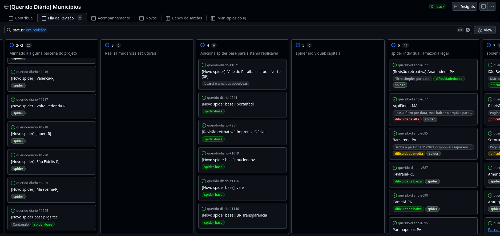
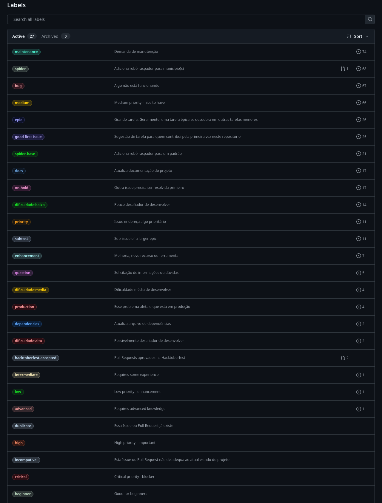

## Convergente

### Visualização do fluxo de trabalho
O projeto oferece uma visão geral do progresso do trabalho por meio do quadro de contribuições e do acompanhamento das milestones.

### Prioridade dos trabalhos
O projeto define prioridades para contribuições e issues, dando preferência à manutenção e ao funcionamento das funcionalidades existentes.

### Melhoria contínua
Como o projeto utiliza scrapers, enfrenta constantemente problemas de compatibilidade. Para lidar com isso, aprimora continuamente as ferramentas e os templates de submissão.

### Puxar trabalho (pull)
Os contribuidores são incentivados a assumir trabalhos mais simples e podem escolher tarefas de uma lista definida.

## Divergente

### Limitação do trabalho em progresso
O projeto não define limites para o trabalho em progresso (WIP). A etapa de revisão é especialmente importante nesse aspecto: sem um limite, o volume de contribuições pendentes pode ultrapassar a capacidade dos revisores, aumentando o tempo de espera e o risco de bugs críticos permanecerem sem resolução.

"A intuição engana. Começar mais itens parece produzir mais, mas o throughput é limitado pela capacidade do time, não pela quantidade de coisas iniciadas. Quando o WIP passa da capacidade de foco, a troca de contexto consome tempo e a entrega cai." *[1]*

### Dificuldade em identificar classes de serviço
A grande quantidade de tags utilizadas dificulta a identificação das classes de serviço.

"A política por classe ordena Urgente > Data Fixa > Padrão > Intangível, garantindo que os itens sensíveis a prazo passem à frente."*[1]*

### Independência do trabalho
Uma das vantagens do Kanban é permitir que o trabalho avance de forma independente. No entanto, a divisão das tarefas entre revisores e contribuidores exige acompanhamento e coordenação. Isso prejudica a métrica de eficiência.

*[1]* [Kanban Global](https://opensource.com/article/18/4/keep-your-project-organized-git-repo)