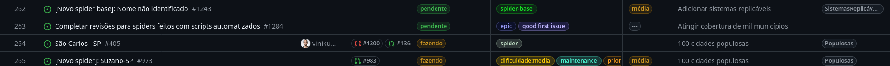
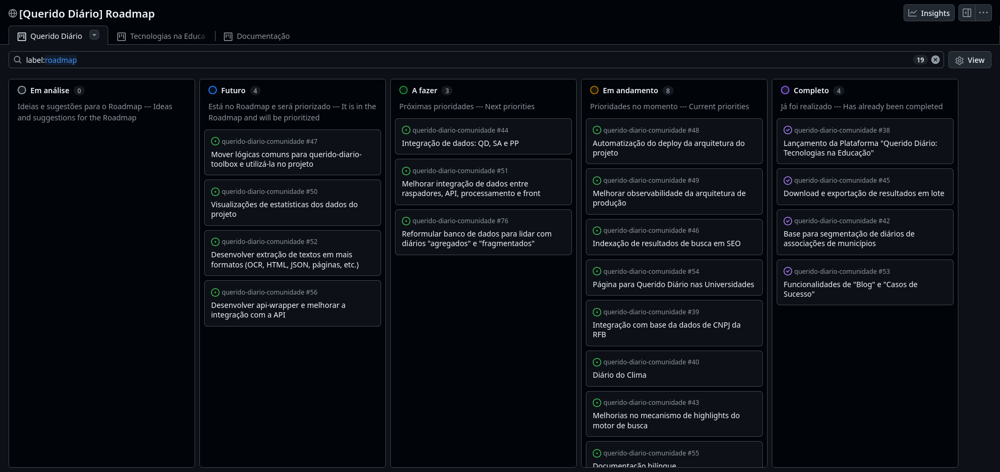
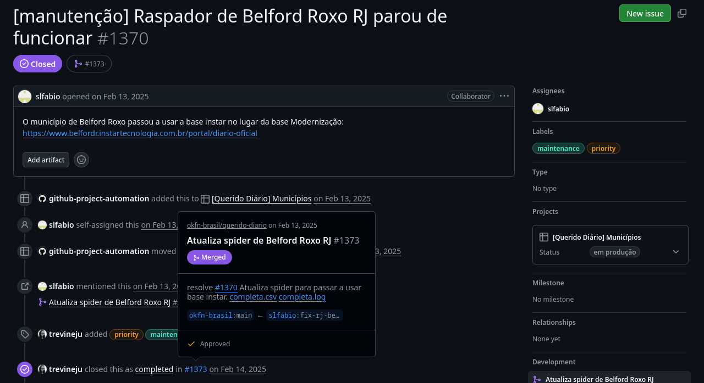
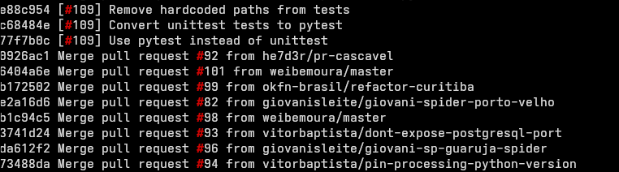
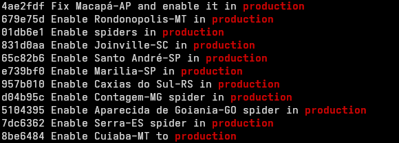
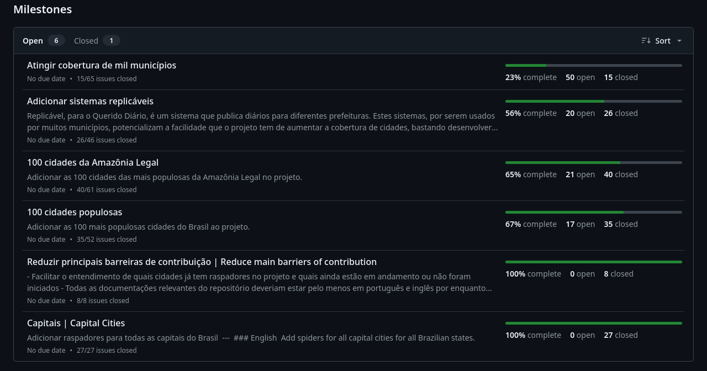

# Evidências do uso do Kanban

## 1. Fluxo implícito de Kanban

**Fluxo principal:**  
Novo → Pendente → Fazendo → Em revisão → Em produção

**Fluxo alternativo:**  
Novo → Bloqueada → Fim

## 2. Prioridades relacionadas às metas 1 a 8

| Prioridade | Descrição | Onde encontrar |
|---:|---|---|
| 1 | Manutenção de raspadores em produção | `maintenance` |
| 2 | Adição de raspadores para municípios solicitados por organizações parceiras | Podem ser marcadas com `priority` |
| 3 | Implementação de melhorias estruturais no repositório | `enhancement` |
| 4 | Adição de spider base | `spider-base` |
| 5 | Adição de raspador para município que é capital | `capitais` |
| 6 | Adição de raspador para município da Amazônia Legal | `100 cidades da Amazônia Legal` |
| 7 | Adição de raspador para município populoso | `100 cidades populosas` |
| 8 | Adição de raspador não associado às metas | Sem label |

## 3. Uso explícito do Kanban no quadro de Roadmap

As metas usam o Kanban explicitamente, com as seguintes etapas:

**Em análise → Futuro → A fazer → Em andamento → Completo**

## 4. Fechamento de issues

As issues são fechadas por meio de merges que concluem a atividade correspondente.

## 5. Referências a issues

Os PRs fazem referência diretamente às issues correspondentes e são fehcadas após o merge do branch colaborativo. 

## 6. Citações no log

O log registra etapas do Kanban, como `production`.

## 7. As milestones são atribuidas aos issues de expansão 

As métricas de conclusão são medidas e agrupadas, o que faz parte da metodologia visual do Kanban

